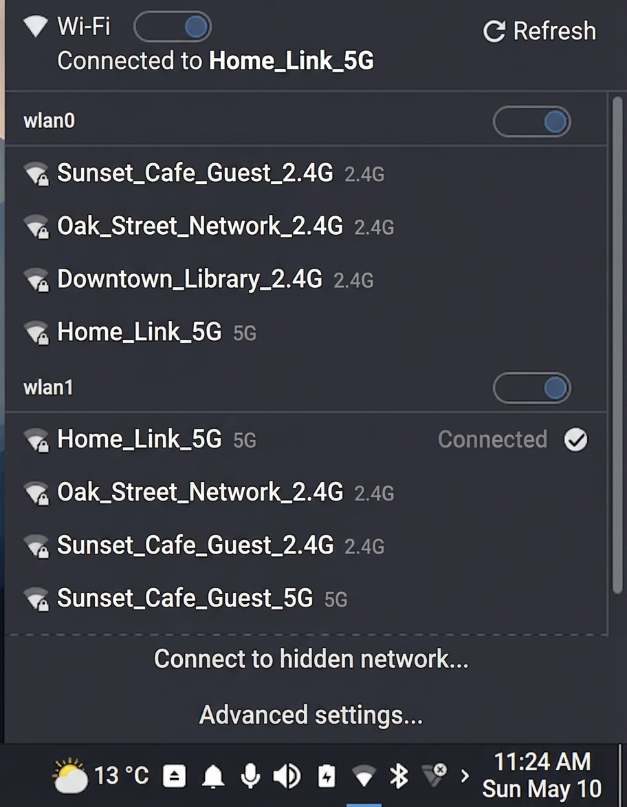

# xfce-net-plugin

*[Español abajo](#español)*

---

An Xfce panel plugin that replaces `nm-applet`. Shows Wi-Fi status and lets you connect, disconnect, and manage networks directly from the panel, without relying on external tools.

### Screenshot


*GTK theme: Qogir-dark — Icon theme: Papirus*

### Features

- Direct NetworkManager communication via DBus (no libnm)
- Multiple Wi-Fi adapter support
- Secure network detection (WPA2/WPA3)
- Band indicator (2.4G / 5G / 6G)
- Connect to hidden networks
- VPN support (WireGuard and NM profiles)
- Ethernet section, also for USB tethering (visible when a cable is plugged in or the adapter is turned off)
- Global Wi-Fi switch and per-adapter switch
- Remembers turned-off adapters across reboots (optional)
- Answers NetworkManager password requests (replaces that part of `nm-applet`)
- Network search inside the popup (magnifier button, Ctrl+F, or just start typing)
- Right-click menu on each network: connect, details, QR, auto-connect, forget
- Keyboard navigation
- Forget saved networks, with inline confirmation
- Network details: IP, gateway, DNS, IPv6, channel, BSSID
- QR code to share the connected network (optional, requires libqrencode)
- Captive portal notice with a "Sign in" button (hotels, cafés, airports)
- Desktop notifications (optional, requires libnotify)
- Option to prefer `nm-applet` icons when your icon theme provides them
- Configurable popup size from Properties
- Persistent config at `~/.config/xfce4/panel/xfce-net-plugin.ini`
- Internationalization: es, en, de, fr, pt_BR, it, nl, pl, ru, zh_CN, ja

### Installation

#### Pre-built packages

| Distro | Package |
|--------|---------|
| Debian 12 / Debian 13 (amd64) | [xfce-net-plugin_1.0.0-1_amd64.deb](https://github.com/Tantin1/xfce-net-plugin/releases/tag/v1.0.0) |
| Arch Linux and derivatives (x86_64) | [xfce-net-plugin-1.0.0-1-x86_64.pkg.tar.zst](https://github.com/Tantin1/xfce-net-plugin/releases/tag/v1.0.0) |

#### Build from source

**Arch Linux (CachyOS, Manjaro, EndeavourOS, Garuda, etc.)**

```bash
sudo pacman -S git cmake pkgconf gtk3 xfce4-panel gettext
# optional / opcional: QR, notifications / notificaciones, Meson
sudo pacman -S qrencode libnotify meson
```

**Debian 12 / Debian 13**

```bash
sudo apt install git cmake pkg-config libgtk-3-dev libxfce4panel-2.0-dev gettext
# optional / opcional: QR, notifications / notificaciones, Meson
sudo apt install libqrencode-dev libnotify-dev meson ninja-build
```

**Build & install (all distros)**

Using CMake:
```bash
git clone https://github.com/Tantin1/xfce-net-plugin.git
cd xfce-net-plugin
cmake -S src -B build
cmake --build build
sudo cmake --install build
xfce4-panel -r
```

Using Meson:
```bash
git clone https://github.com/Tantin1/xfce-net-plugin.git
cd xfce-net-plugin
meson setup build src
meson compile -C build
sudo meson install -C build
xfce4-panel -r
```

### Notes

- **Running alongside `nm-applet`:** if `nm-applet` is still running, turn off *Respond to password requests* in Properties → Network, or remove `nm-applet` from autostart. Otherwise both will try to show the password dialog.
- **Captive portal notice:** requires NetworkManager's connectivity check. On Debian, install `network-manager-config-connectivity-debian`; without it the notice never appears.

### Compatibility

- Arch Linux (CachyOS, Manjaro, EndeavourOS, Garuda, etc.)
- Debian 12 (Bookworm)
- Debian 13 (Trixie)
- Xfce 4.18+ on X11

### License

GPL v2. See [LICENSE](LICENSE).

### Credits

Developed by [Tantin1](https://github.com/Tantin1).

---

## Español

<a name="español"></a>

Plugin de panel para Xfce que reemplaza a `nm-applet`. Muestra el estado de la red Wi-Fi y permite conectarse, desconectarse y gestionar redes directamente desde el panel, sin depender de herramientas externas.

### Captura


*Tema GTK: Qogir-dark — Tema de íconos: Papirus*

### Características

- Comunicación directa con NetworkManager vía DBus (sin libnm)
- Soporte para múltiples adaptadores Wi-Fi
- Detección de redes seguras (WPA2/WPA3)
- Indicador de banda (2.4G / 5G / 6G)
- Conexión a redes ocultas
- Soporte VPN (WireGuard y perfiles NM)
- Sección Ethernet, también para conexión compartida por USB (visible cuando hay cable enchufado o el adaptador está apagado)
- Interruptor global de Wi-Fi e interruptor por adaptador
- Recuerda los adaptadores apagados entre reinicios (opcional)
- Responde a los pedidos de contraseña de NetworkManager (reemplaza esa parte de `nm-applet`)
- Búsqueda de redes dentro del popup (botón de lupa, Ctrl+F o simplemente empezar a escribir)
- Menú con clic derecho sobre cada red: conectar, detalles, QR, conexión automática, olvidar
- Navegación con teclado
- Olvidar redes guardadas, con confirmación en el mismo popup
- Detalles de la red: IP, puerta de enlace, DNS, IPv6, canal, BSSID
- Código QR para compartir la red conectada (opcional, requiere libqrencode)
- Aviso de portal cautivo con botón "Iniciar sesión" (hoteles, bares, aeropuertos)
- Notificaciones de escritorio (opcional, requiere libnotify)
- Opción para preferir los íconos de `nm-applet` cuando el tema de íconos los trae
- Tamaño del popup configurable desde Propiedades
- Configuración persistente en `~/.config/xfce4/panel/xfce-net-plugin.ini`
- Internacionalización: es, en, de, fr, pt_BR, it, nl, pl, ru, zh_CN, ja

### Instalación

#### Paquetes pre-compilados

| Distro | Paquete |
|--------|---------|
| Debian 12 / Debian 13 (amd64) | [xfce-net-plugin_1.0.0-1_amd64.deb](https://github.com/Tantin1/xfce-net-plugin/releases/tag/v1.0.0) |
| Arch Linux y derivadas (x86_64) | [xfce-net-plugin-1.0.0-1-x86_64.pkg.tar.zst](https://github.com/Tantin1/xfce-net-plugin/releases/tag/v1.0.0) |

#### Compilar desde fuente

**Arch Linux (CachyOS, Manjaro, EndeavourOS, Garuda, etc.)**

```bash
sudo pacman -S git cmake pkgconf gtk3 xfce4-panel gettext
# optional / opcional: QR, notifications / notificaciones, Meson
sudo pacman -S qrencode libnotify meson
```

**Debian 12 / Debian 13**

```bash
sudo apt install git cmake pkg-config libgtk-3-dev libxfce4panel-2.0-dev gettext
# optional / opcional: QR, notifications / notificaciones, Meson
sudo apt install libqrencode-dev libnotify-dev meson ninja-build
```

**Compilación e instalación (todas las distros)**

Con CMake:
```bash
git clone https://github.com/Tantin1/xfce-net-plugin.git
cd xfce-net-plugin
cmake -S src -B build
cmake --build build
sudo cmake --install build
xfce4-panel -r
```

Con Meson:
```bash
git clone https://github.com/Tantin1/xfce-net-plugin.git
cd xfce-net-plugin
meson setup build src
meson compile -C build
sudo meson install -C build
xfce4-panel -r
```

### Notas

- **Junto a `nm-applet`:** si `nm-applet` sigue corriendo, desactivá *Responder pedidos de contraseña* en Propiedades → Red, o sacá `nm-applet` del inicio automático. Si no, los dos intentan mostrar el diálogo de contraseña.
- **Aviso de portal cautivo:** necesita la comprobación de conectividad de NetworkManager. En Debian, instalá `network-manager-config-connectivity-debian`; sin eso el aviso nunca aparece.

### Compatibilidad

- Arch Linux (CachyOS, Manjaro, EndeavourOS, Garuda, etc.)
- Debian 12 (Bookworm)
- Debian 13 (Trixie)
- Xfce 4.18+ sobre X11

### Licencia

GPL v2. Ver [LICENSE](LICENSE).

### Créditos

Desarrollado por [Tantin1](https://github.com/Tantin1).
